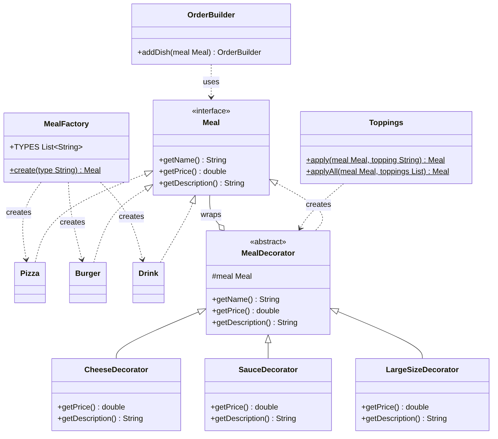
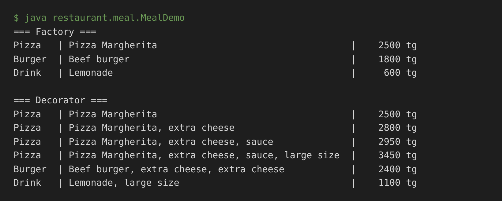
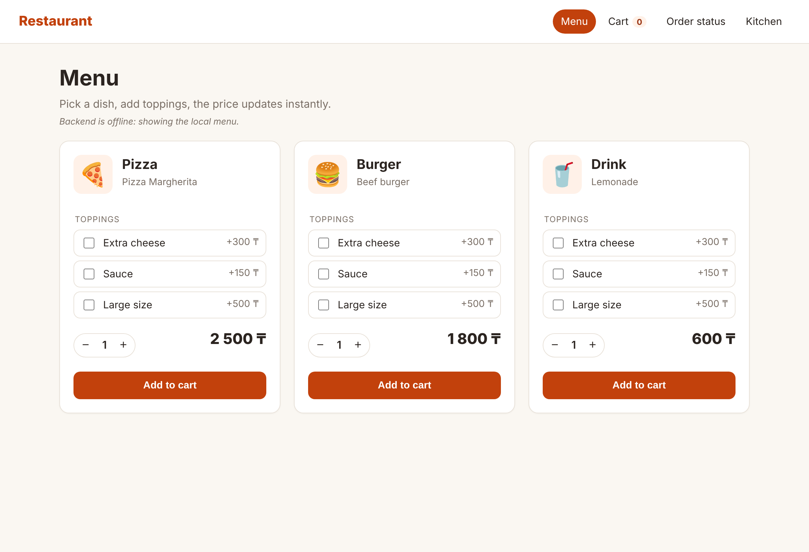
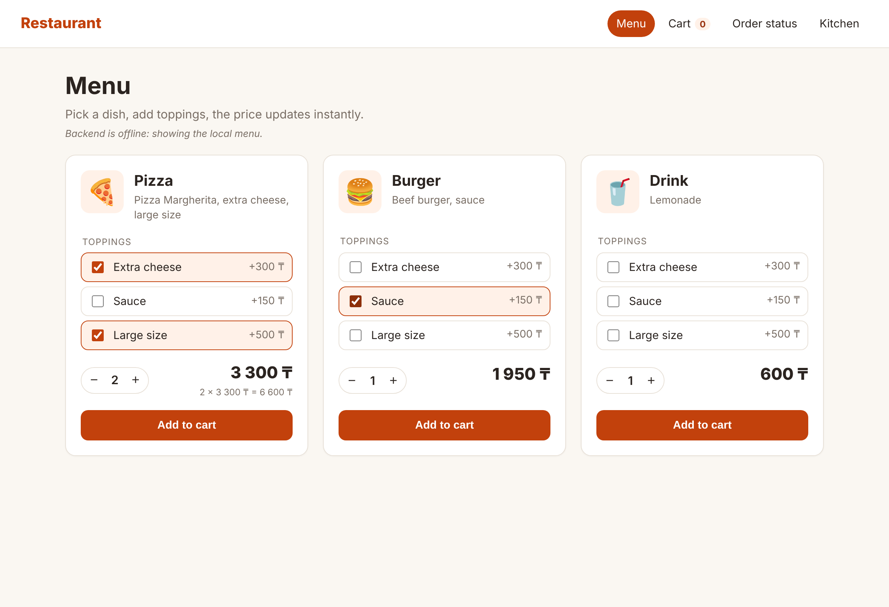

# Restaurant Ordering System: Factory and Decorator

Author's part: **Factory + Decorator** (packages `restaurant.meal`, `restaurant.decorator`) and the menu page of the web client (`frontend/index.html`).

## 1. Common interface `Meal`

All parts of the system work with one interface agreed by the team:

```java
public interface Meal {
    String getName();
    double getPrice();
    String getDescription();
}
```

Concrete dishes, decorated dishes and the order all depend only on this interface, so a pizza with three toppings is used exactly like a plain pizza.

## 2. Factory

### Problem
The client (REST API, facade, console) receives the dish type as text, e.g. `"pizza"` from the JSON request. If every client wrote `new Pizza()`, `new Burger()` and a chain of `if`s itself, the knowledge "which class stands behind which type" would be spread over the whole program. Adding a new dish would mean changing every such place.

### Solution
`MealFactory.create(type)` is the single place that turns a type into an object:

```java
public static Meal create(String type) {
    switch (type.trim().toLowerCase()) {
        case "pizza":  return new Pizza();
        case "burger": return new Burger();
        case "drink":  return new Drink();
        default: throw new IllegalArgumentException("Unknown meal type: " + type);
    }
}
```

The client gets a `Meal` and does not know the concrete class. The input is case-insensitive, an unknown type or `null` raises `IllegalArgumentException`. `MealFactory.TYPES` lists the available types and is used to build the menu.

### Participants
| Role | Class |
|------|-------|
| Product (interface) | `Meal` |
| Concrete products | `Pizza`, `Burger`, `Drink` |
| Factory (Simple Factory) | `MealFactory` |
| Client | `RestaurantFacade`, `MealDemo`, tests |

### Pros and cons
- (+) Object creation is in one place; clients depend only on `Meal`.
- (+) A new dish = a new class + one `case` in the factory, no other changes.
- (+) Invalid types are rejected in one place.
- (-) The factory itself must be edited for each new type (it is a Simple Factory, not a full Factory Method).

## 3. Decorator

### Problem
Every dish can get toppings: extra cheese, sauce, large size, in any combination and even twice. Subclasses like `PizzaWithCheese`, `PizzaWithCheeseAndSauce`, `BurgerLargeWithSauce`… would explode in number (3 dishes × 2³ combinations = 24 classes, and repeated toppings are impossible at all).

### Solution
A topping is an object that **wraps** another `Meal` and implements the same interface. The abstract `MealDecorator` stores the wrapped meal and delegates to it; each concrete topping adds its own price and text:

```java
public abstract class MealDecorator implements Meal {
    protected final Meal meal;
    protected MealDecorator(Meal meal) { this.meal = meal; }
    public String getName()        { return meal.getName(); }
    public double getPrice()       { return meal.getPrice(); }
    public String getDescription() { return meal.getDescription(); }
}

public class CheeseDecorator extends MealDecorator {
    public CheeseDecorator(Meal meal) { super(meal); }
    public double getPrice()       { return meal.getPrice() + 300; }
    public String getDescription() { return meal.getDescription() + ", extra cheese"; }
}
```

Toppings are combined at runtime by wrapping:

```java
Meal pizza = MealFactory.create("pizza");          // 2500
pizza = new CheeseDecorator(pizza);                // 2800
pizza = new SauceDecorator(pizza);                 // 2950
pizza = new LargeSizeDecorator(pizza);             // 3450
pizza.getDescription(); // "Pizza Margherita, extra cheese, sauce, large size"
```

| Topping | Class | Price |
|---------|-------|-------|
| Extra cheese | `CheeseDecorator` | +300 ₸ |
| Sauce | `SauceDecorator` | +150 ₸ |
| Large size | `LargeSizeDecorator` | +500 ₸ |

For the REST API the helper `Toppings.applyAll(meal, List.of("cheese", "large"))` applies toppings given by name.

### Participants
| Role | Class |
|------|-------|
| Component | `Meal` |
| Concrete components | `Pizza`, `Burger`, `Drink` |
| Decorator | `MealDecorator` |
| Concrete decorators | `CheeseDecorator`, `SauceDecorator`, `LargeSizeDecorator` |

### Pros and cons
- (+) Any combination of toppings without new classes; the same topping can be added twice.
- (+) A new topping = one small class; dishes and other toppings are not changed (Open/Closed principle).
- (+) A decorated dish is still a `Meal`, so the order, cart and payment code do not change.
- (-) Many small objects; the description depends on the wrapping order.
- (-) It is hard to remove a topping from the middle of a chain (we rebuild the meal instead).

## 4. Connection with other patterns

- **Builder** (person 2): `OrderBuilder.addDish(Meal)` accepts a decorated meal; `Order.getTotalPrice()` sums `getPrice()` of all meals.
- **Facade** (person 3): `RestaurantFacade.placeOrder()` calls `MealFactory.create(type)` and `Toppings.applyAll(...)` for every item of the request.

```java
Order order = new OrderBuilder()
        .addDish(new CheeseDecorator(MealFactory.create("pizza")))
        .addDish(MealFactory.create("drink"))
        .table(3)
        .build();
order.getTotalPrice(); // 3400
```

## 5. UML class diagram



## 6. Testing

`MealFactoryDecoratorTest` (JUnit 5, 8 tests):
- the factory returns the right class for each type, ignores case, rejects unknown types and `null`;
- base prices are correct;
- one topping changes price and description, the name stays the same;
- three toppings stack (2500 + 300 + 150 + 500 = 3450);
- the same topping twice is counted twice;
- toppings by name work and an unknown topping is rejected;
- a decorated meal goes into `Order` through `OrderBuilder` with the right total.

Console check (`restaurant.meal.MealDemo`):



## 7. Web client: menu page

`frontend/index.html` + `js/menu.js` show a card for every dish. Ticking a topping recalculates the price and description the same way the Decorator does on the server (base price + price of each selected topping). The quantity can be changed; **Add to cart** saves the item to `localStorage` for the cart page.

The menu is loaded from `GET /menu`; while the server is not running, the page uses a local copy of the menu with the same prices.

Menu:



Toppings selected (pizza: cheese + large ×2, burger: sauce):



## 8. Why these patterns here

- **Without Factory**, the API and the facade would contain `switch`/`new` for dish types in several places, and every new dish would require changes across the code.
- **Without Decorator**, we would need a class for every combination of dish and toppings, or a single `Meal` class full of boolean flags (`hasCheese`, `hasSauce`, `isLarge`) and `if`s in `getPrice()`, which breaks every time a topping is added.
